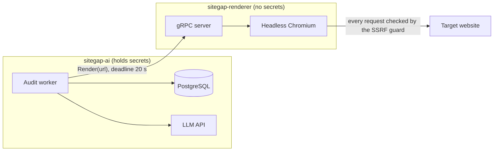
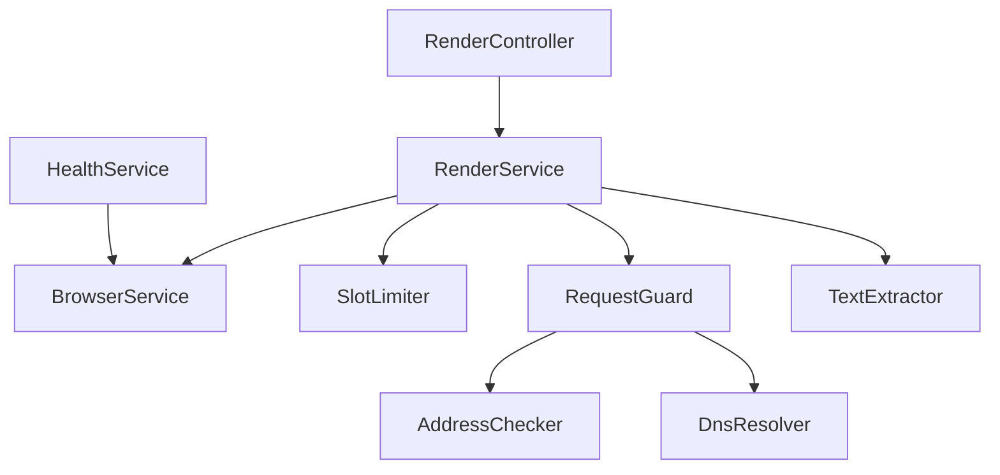
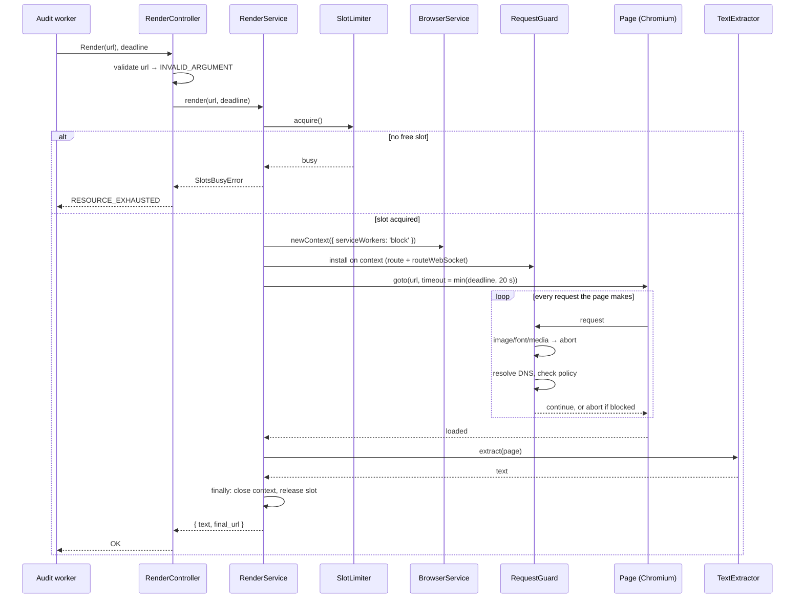
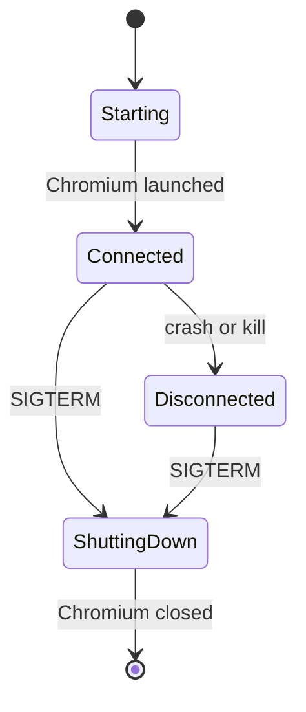
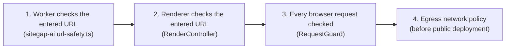

# ARCHITECTURE.md — SiteGap Renderer

This document describes how the service is built. What it does and the contract
it keeps live in `docs/SPEC.md`; the order of work lives in `TASKS.md`.

---

## 1. System Context

The renderer sits between the sitegap-ai audit worker and the open internet. It
is the only component that runs untrusted JavaScript, so it is also the one that
holds nothing worth stealing.



This split is the **Bulkhead** pattern: a browser crash or compromise stays
inside the renderer's container and cannot reach the database or the API keys.

---

## 2. Module Structure

```text
proto/
  sitegap/renderer/v1/renderer.proto   # the contract, copied into sitegap-ai
src/
  main.ts                              # starts the gRPC microservice
  app.module.ts
  config/                              # env parsing and validation
  render/
    render.controller.ts               # gRPC handler: validate, call, map errors
    render.service.ts                  # runs one render from start to finish
  browser/
    browser.service.ts                 # one Chromium per process
    slot-limiter.ts                    # at most N renders at once
  safety/
    address-policy.ts                  # which IP addresses are blocked
    dns-resolver.ts                    # wraps dns.lookup, so tests can replace it
    request-guard.ts                   # context.route handler
  extraction/
    text-extractor.ts                  # page → readable text (SPEC §6)
  health/                              # grpc.health.v1
test/                                  # e2e tests and the local test server
```



| Module | Role | Pattern |
|---|---|---|
| `render` | The controller only translates between gRPC and the service. `RenderService` is the single entry point that runs every step in order. | **Facade** |
| `browser` | `BrowserService` owns the one Chromium process. NestJS providers are singletons by default, so every render shares it. `SlotLimiter` counts free slots. | **Singleton**, **Semaphore** |
| `safety` | `AddressChecker` answers "is this IP blocked?". It is a separate provider so e2e tests can swap it for a checker that allows their local server. | **Strategy** |
| `extraction` | Pure function of the page's DOM. No I/O, easy to unit test. | — |
| `health` | Reads the browser's state; owns no state of its own. | — |
| `config` | Reads env once at startup and fails fast on bad values. | — |

---

## 3. Render Sequence



Steps that must never be skipped happen in `finally`: the context is closed and
the slot is released on success, on error, and on timeout alike.

---

## 4. Browser Lifecycle



- **Starting:** health reports `NOT_SERVING`; `Render` returns `UNAVAILABLE`.
- **Connected:** health reports `SERVING`.
- **Disconnected:** health reports `NOT_SERVING`; `Render` returns
  `UNAVAILABLE`. What happens next is open — see §9.
- **ShuttingDown:** follows SPEC §11. NestJS shutdown hooks
  (`enableShutdownHooks`, `onApplicationShutdown`) close Chromium last, after
  in-flight renders finish.

---

## 5. Concurrency

Each render holds a slot. When all slots are busy, a new call is rejected at
once with `RESOURCE_EXHAUSTED`.

Why reject instead of queueing: the caller has a 20 s deadline. Time spent
waiting in an internal queue comes out of that deadline, so a queued call would
often time out anyway — after holding a connection for nothing. Rejecting early
is **backpressure**: the caller learns at once that the renderer is full, and
its own job retry handles it.

The default of 2 slots matches the worker's concurrency, so in normal operation
the limit is never hit.

---

## 6. SSRF Guard

The guard is one layer of several. Each layer assumes the others can fail —
**defense in depth**:



- `RequestGuard` is installed with `context.route('**/*')`, so it covers every
  page in the context, including popups.
- `serviceWorkers: 'block'` — interception does not see service worker traffic.
- `context.routeWebSocket` closes every WebSocket.
- `DnsResolver` is its own provider: unit tests replace it, so no test depends
  on real DNS.
- Layer 4 closes the DNS rebinding gap (SPEC §8.4). Layers 1–3 cannot.

---

## 7. Error Handling

Services throw **domain errors** that know nothing about gRPC. One place — a
NestJS exception filter — maps them to status codes. This keeps services
testable without a transport, and the mapping in one table.

| Domain error | Status |
|---|---|
| `InvalidUrlError` | `INVALID_ARGUMENT` |
| `BlockedUrlError` | `PERMISSION_DENIED` |
| `RenderTimeoutError` | `DEADLINE_EXCEEDED` |
| `SlotsBusyError` | `RESOURCE_EXHAUSTED` |
| `BrowserUnavailableError` | `UNAVAILABLE` |
| anything else | `INTERNAL` |

The filter logs the full error on the server and sends only a short, safe
message to the client.

> **Note (design decision — 2026-10-29): an exception filter, not
> `RpcException` in services.** Throwing `RpcException` straight from services
> is simpler, but ties every service to gRPC: their unit tests would assert on
> status codes, and the code-to-error table would be spread over many files.
> With a filter, services throw plain domain errors and the whole table lives in
> one place.

---

## 8. Testing

| Level | Tool | What is real | What is replaced |
|---|---|---|---|
| Unit | Jest + `Test.createTestingModule` | the class under test | Playwright, `DnsResolver`, `AddressChecker` via `overrideProvider` |
| e2e | Jest + `@grpc/grpc-js` client | gRPC, Chromium, a local HTTP server | `AddressChecker` → a test checker that allows only the test server's origin |

The local test server runs on `127.0.0.1`, which the real checker blocks. The
test checker allows exactly that host and port, so the guard stays on and
requests to any other loopback port are still blocked.

---

## 9. Open Questions

Each question is decided in its phase and recorded here.

| Question | Phase | Decision |
|---|---|---|
| Which tool generates TypeScript types from the proto? | 2 | `ts-proto` with `nestJs=true` and lean output (no extra runtime dependencies) |
| When Chromium crashes: relaunch it in-process, or exit and let the container restart? | 3 | Exit process (`process.exit(1)`) and let the container orchestrator restart the container cleanly (Crash-only software) |
| Does `context.route` see each redirect hop? If not, how do we check them? | 4 | — |
| When does a page count as rendered: `load`, `networkidle`, or waiting for text? | 5 | — |

---

## 10. Relation to sitegap-ai

Three things exist in both repositories and must stay in step:

| What | sitegap-ai | sitegap-renderer |
|---|---|---|
| Contract | copy of `renderer.proto` | `proto/sitegap/renderer/v1/renderer.proto` (source) |
| Extraction rules | `basic-scraper.ts` | `extraction/text-extractor.ts` |
| SSRF test cases | `url-safety.test.ts` | `safety/*.spec.ts` |

Revisit when a second consumer of the contract appears: publish the proto
through a registry (e.g. Buf) instead of copying it.
